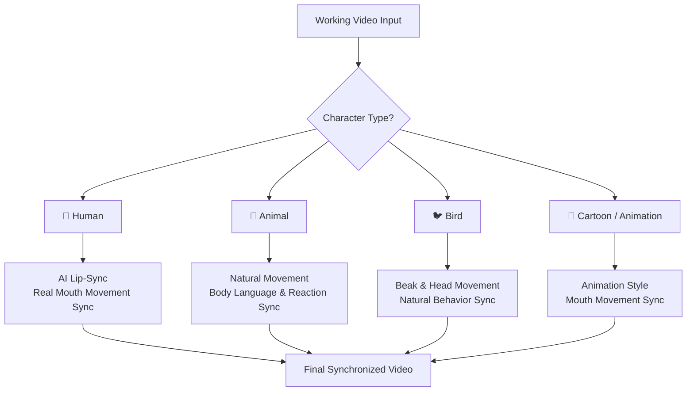
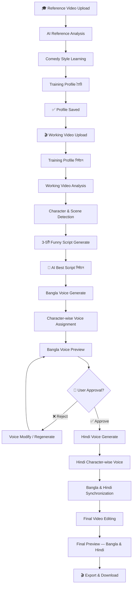

# 🎬 AI Funny Dubbing & Video Production Studio
### Project Idea Document

---

> [!IMPORTANT]
> এটি একটি সম্পূর্ণ AI-powered Automated Funny Video Production Studio — যেখানে User শুধু Video Upload করবে এবং AI বাকি সব Production কাজ করবে।

---

## 📌 Project Vision

একটি Advanced AI-powered System যা Trending Funny Dubbing Video থেকে Comedy Style শিখে, Original Working Video বিশ্লেষণ করে, Creative Funny Script তৈরি করে এবং সম্পূর্ণ **Bangla ও Hindi Dubbed Final Video** তৈরি করে দেয় — Character-wise আলাদা Voice ও Adaptive Visual Synchronization সহ।

---

## 🗂️ Main Dashboard Sections

| Section | বিবরণ |
|---|---|
| 🎓 Training / Reference Library | Reference Funny Video Upload ও Comedy Style শেখার জায়গা |
| 🎬 Create New Project | নতুন Working Video দিয়ে Production শুরু |
| 📁 My Projects | সব পুরোনো Project-এর তালিকা |
| 🎙️ Voice Library | সব Available Voice-এর Collection |
| ⚙️ AI Processing Status | Real-time Processing Progress |
| 📺 Final Videos | তৈরি হওয়া Final Video দেখা ও Download |
| ⚙️ Settings | API Key, Preferences ইত্যাদি |

---

## 🎓 SECTION ONE — Training / Reference Video Library

### মূল উদ্দেশ্য
User একাধিক Trending Funny Dubbing Video Upload করবে। এই ভিডিওগুলো শুধু AI-কে **Comedy Style ও Expected Output** বোঝানোর জন্য — Working Video হিসেবে ব্যবহার করা যাবে না।

### AI কী শিখবে?

```
Comedy Style           →  Humour Pattern, Punchline Style
Character Personality  →  Voice Pitch, Tone, Delivery
Timing                 →  Comedy Timing, Reaction Timing
Editing Style          →  Sound Effects, Background Music
Visual Style           →  Subtitle Style, Synchronization Method
```

### বিভিন্ন Video Type থেকে আলাদা Learning

| Video Type | AI কী শিখবে |
|---|---|
| 👤 Human | Lip-Sync Style, Facial Expression Dubbing |
| 🐾 Animal | Body Language, Reaction-based Sync |
| 🐦 Bird | Beak Movement, Head Movement Sync |
| 🎨 Cartoon / Animation | Mouth Movement Animation Style |

### Training Profile
সব Reference Video বিশ্লেষণের পর AI একটি **Reusable Comedy Style Profile** তৈরি করবে:

- Preferred Comedy Style
- Preferred Voice & Character Voice
- Dialogue Style ও Humour Pattern
- Editing Style ও Sound Design Preference
- Visual Synchronization Preference

> [!NOTE]
> নতুন Reference Video যোগ করলে Training Profile Update হবে। Reference Video-এর Original Dialogue কখনো Copy করা যাবে না — শুধু **Style ও Creative Direction** নেওয়া হবে।

---

## 🎬 SECTION TWO — Working Video / Create New Project

### মূল উদ্দেশ্য
User তার Original Video Upload করবে এবং পূর্বে তৈরি Training Profile নির্বাচন করবে। এই Original Video-ই হবে Final Dubbing-এর **মূল Footage**।

### Video Upload Support
- ✅ MP4, MOV, MKV Format
- ✅ Duration ও Resolution Detection
- ✅ Audio Detection
- ✅ Upload Progress ও File Validation

---

## 🔍 Working Video Analysis

Script তৈরির আগে AI সম্পূর্ণ Video বিশ্লেষণ করবে:

```
✔ Video Type Identification (Human / Animal / Bird / Cartoon)
✔ Character Detection & Identification
✔ Scene Detection with Timestamp
✔ Character Action & Body Language
✔ Facial Expression (যেখানে প্রযোজ্য)
✔ Character Interaction & Speaking Turn
✔ Funny Moment Detection
✔ Story Context & Comedy Opportunity
```

প্রতিটি Scene-এর জন্য **Timestamp + Visual Description** তৈরি হবে। এই Analysis-ই Script Generation-এর ভিত্তি।

---

## 📝 Funny Script Generation

AI ন্যূনতম **৩-৫টি আলাদা Funny Dubbing Script** তৈরি করবে — সবগুলো User দেখতে পাবে।

### প্রতিটি Script-এ থাকবে

| উপাদান | বিবরণ |
|---|---|
| Script Title | Script-এর নাম |
| Scene Number & Timestamp | কোন দৃশ্যে কখন |
| Character Name | কে বলছে |
| Character Dialogue | কী বলছে |
| Character Emotion | কীভাবে বলছে |
| Voice Delivery Style | Delivery Instruction |
| Comedy Timing & Punchline | কখন Punch আসবে |
| Suggested Sound Effects | কোন Sound Effect দরকার |

> [!IMPORTANT]
> Script অবশ্যই Original Video-এর Visual Action ও Story Context-এর সঙ্গে মিলতে হবে। Comedy হতে হবে **Natural, Creative ও Entertaining**।

---

## 🤖 Automatic Best Script Selection

> [!IMPORTANT]
> এটি অত্যন্ত গুরুত্বপূর্ণ Feature — User-এর কাছ থেকে Script Approval নেওয়া হবে না।

AI নিজেই নিচের Criteria বিশ্লেষণ করে Best Script বেছে নেবে:

- Comedy Quality & Originality
- Scene ও Character Relevance
- Dialogue Quality ও Entertainment Value
- Comedy Timing ও Punchline Quality

✅ Best Script নির্বাচনের পর **স্বয়ংক্রিয়ভাবে Bangla Voice Generation শুরু হবে।**
✅ সব Script Project-এ সংরক্ষিত থাকবে।

---

## 🎙️ Character-wise Different Voice System

প্রতিটি Speaking Character-এর জন্য **আলাদা Voice** ব্যবহার করা হবে।

```
Character 1  →  Voice A
Character 2  →  Voice B
Character 3  →  Voice C
Character 4  →  Voice D
```

একই Character পুরো Video-তে **একই Voice Identity** বজায় রাখবে।

### Voice Personality Options

| ধরন | উদাহরণ |
|---|---|
| লিঙ্গ | Male, Female |
| বয়স | Young, Old |
| Pitch | Deep, High Pitch |
| Style | Funny, Cartoon, Expressive |

> [!NOTE]
> Character-এর Personality ও আচরণ অনুযায়ী AI নিজেই উপযুক্ত Voice নির্বাচন করবে। Bangla ও Hindi উভয়ের জন্য আলাদা Character Voice Mapping সংরক্ষণ হবে।

---

## 🗣️ Bangla Voice Generation

- Natural Conversational Bangla
- বাংলাদেশের দর্শক-উপযোগী ভাষা
- প্রতিটি Dialogue-এ Humour, Emotion ও Comedy Timing
- প্রতিটি Character-এর জন্য আলাদা Voice
- Generation-এর পর User-কে Preview দেওয়া হবে

---

## ✅ Bangla Voice Review & Approval

এটি **বাধ্যতামূলক Approval Stage**। User নিচের বিষয়গুলো যাচাই করবে:

- [ ] Dialogue কি Video-এর সঙ্গে মিলেছে?
- [ ] Character অনুযায়ী Voice সঠিক?
- [ ] Comedy ঠিকমতো কাজ করছে?
- [ ] Punchline ও Timing সঠিক?
- [ ] Voice Natural ও Entertaining?

### Available Controls

```
▶ Play / Pause                  📥 Download Audio
🔊 Full Voice Preview           🔄 Regenerate Voice
🎙 Individual Dialogue Preview  ↕ Change Pitch / Speed
👤 Character-wise Preview       😄 Change Emotion
✏️ Edit Individual Dialogue     🔁 Change Voice
```

> [!CAUTION]
> User Approve না করা পর্যন্ত Final Video Production শুরু হবে না। Reject করলে পরিবর্তনের সুযোগ দেওয়া হবে।

---

## 🇮🇳 Hindi Voice Generation

Bangla Approval-এর পর Hindi Version তৈরি হবে।

- একই Best Script-এর Comedy Concept ও Scene Structure বজায় থাকবে
- **Word-to-Word Translation নয়** — Natural Hindi Adaptation
- Hindi-speaking দর্শকরাও একইভাবে Comedy উপভোগ করতে পারবে
- প্রতিটি Character-এর জন্য আলাদা Hindi Voice
- উভয় ভাষায় Character-এর Voice Personality সামঞ্জস্যপূর্ণ রাখা হবে

---

## 🔄 Adaptive Visual & Voice Synchronization System

> [!IMPORTANT]
> সব ধরনের Video-তে একই Lip-Sync Method ব্যবহার করা যাবে না। AI Video-এর ধরন অনুযায়ী উপযুক্ত Method নির্বাচন করবে।

### Synchronization Method by Video Type



| Video Type | Synchronization Method |
|---|---|
| 👤 Human | AI Lip-Sync — নতুন Dialogue অনুযায়ী মুখের নড়াচড়া |
| 🐾 Animal | Natural Movement, Reaction ও Body Language ভিত্তিক |
| 🐦 Bird | Beak Movement, Head Movement ও Natural Behaviour ভিত্তিক |
| 🎨 Cartoon | Character Animation Style অনুযায়ী Mouth Sync |
| 🚫 Non-speaking | Action-based / Reaction-based / Off-screen Voiceover |

> [!NOTE]
> Lip-Sync সম্ভব না হলে জোর করে প্রয়োগ করা যাবে না। সবচেয়ে গুরুত্বপূর্ণ হলো Final Video যেন **Natural, Funny ও Entertaining** হয়।

---

## 🎞️ Final Video Editing

Voice Approval-এর পর Final Production শুরু:

- Original Dialogue Audio Replace বা Mix
- Character-wise Voice বসানো
- Scene অনুযায়ী Dialogue Synchronize
- Funny Sound Effects যোগ
- Background Music যোগ
- Voice ও Music Balance
- Original Ambient Sound সংরক্ষণ
- Bangla ও Hindi Subtitle তৈরি

> [!WARNING]
> Background Music ও Sound Effects যেন Dialogue-এর Voice ঢেকে না ফেলে।

---

## 📺 Final Video Preview & Export

### দুটি আলাদা Final Video

#### 🇧🇩 VIDEO 1 — Bangla Dubbed
- সম্পূর্ণ বাংলা Dialogue
- Character-wise Different Voice
- Adaptive Visual Synchronization
- বাংলা Subtitle
- Comedy Sound Effects + Background Music

#### 🇮🇳 VIDEO 2 — Hindi Dubbed
- সম্পূর্ণ হিন্দি Dialogue
- Character-wise Different Voice
- Adaptive Visual Synchronization
- হিন্দি Subtitle
- Comedy Sound Effects + Background Music

### Export Settings
- Format: **MP4**
- Resolution: **1080p** (Source সমর্থন করলে)
- Audio: **High Quality**
- Codec: **H.264**
- আলাদা Voiceover Audio Download-এর সুবিধা

---

## 💾 Project Management

প্রতিটি Project আলাদাভাবে Save হবে এবং পরবর্তীতে আগের জায়গা থেকে কাজ চালিয়ে যাওয়া যাবে।

### Project-এ যা সংরক্ষিত থাকবে
```
📹 Original Working Video
🎓 Reference Training Profile
🔍 Video Analysis Data
🎬 Scene Information & Timestamps
📝 All Generated Scripts (3-5টি)
⭐ AI Selected Best Script
🔊 Bangla Voice Files
🔊 Hindi Voice Files
🗺️ Character Voice Mapping
🔄 Synchronization Data
📄 Subtitle Files (Bangla + Hindi)
🎬 Final Video Files (Bangla + Hindi)
```

---

## ⚙️ Processing Status & Error Handling

Real-time Processing Stage দেখানো হবে:

```
1. Uploading
2. Analyzing Video
3. Detecting Characters
4. Generating Scripts (3-5টি)
5. Selecting Best Script
6. Generating Bangla Voice
7. ⏸ Waiting for Voice Approval  ← User Action Required
8. Generating Hindi Voice
9. Processing Synchronization
10. Editing Video
11. Rendering Final Video
12. ✅ Completed
```

- Long Video Processing-এর জন্য **Progress Bar**
- Processing Failed হলে **Error Details**
- সম্ভব হলে আগের সফল Step থেকে **Resume** করার সুবিধা

---

## 🔄 Complete Production Workflow



---

## 🛠️ Technology Requirements (High-level)

> [!NOTE]
> এটি শুধু High-level Idea। বিস্তারিত Architecture পরবর্তীতে তৈরি হবে।

| Category | প্রয়োজনীয় Technology |
|---|---|
| AI Video Understanding | Scene ও Character Detection Model |
| Script Generation | LLM (Large Language Model) |
| Multilingual TTS | Bangla ও Hindi Text-to-Speech |
| Character Voice | Multi-speaker Voice Cloning / Selection |
| Audio Processing | Voice Mixing, Background Music, Sound FX |
| Lip-Sync | AI Lip-Sync Model |
| Adaptive Sync | Video Type-based Sync Engine |
| Video Rendering | Final Video Composition |
| Subtitle | Auto Subtitle Generation |
| Backend | API, Database, File Storage |

> [!CAUTION]
> **কোনো Fake Processing বা Fake Progress ব্যবহার করা যাবে না।** যে Feature বাস্তবে Implement হয়নি, সেটিকে Completed দেখানো যাবে না। প্রতিটি Feature বাস্তব Backend Processing-এর সঙ্গে সংযুক্ত থাকতে হবে।

---

## 🎯 Final Priorities

| অগ্রাধিকার | বিষয় |
|---|---|
| 🥇 | Reference Video থেকে Comedy Style শেখা |
| 🥇 | Working Video সঠিকভাবে বিশ্লেষণ |
| 🥇 | Creative Funny Script তৈরি |
| 🥇 | AI-এর স্বয়ংক্রিয় Best Script Selection |
| 🥇 | Natural Bangla Voice Generation |
| 🥇 | Natural Hindi Voice Generation |
| 🥇 | প্রতিটি Character-এর জন্য আলাদা Voice |
| 🥇 | Human / Animal / Bird / Cartoon অনুযায়ী Adaptive Sync |
| 🥇 | High-quality Final Video Production |

---

## 💡 Core Philosophy

> **"User শুধু Video Upload করবে — AI বাকি সব করবে।"**

User-এর একমাত্র বাধ্যতামূলক কাজ হলো **Bangla Voice Approve করা**। বাকি সব — Script Selection, Voice Generation, Synchronization, Editing, Export — সম্পূর্ণ AI-powered ও Automated।

---

*Document Version: 1.0 | Created: 2026-10-31*
